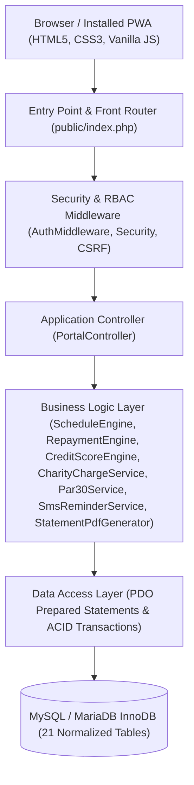

# SIMDA — Software Architecture Reference

## 1. Layered MVC-Style Architecture

SIMDA separates presentation, request handling, domain business logic, and database persistence into four clean layers:

## 2. Core Financial Engines

| Service Class | Responsibility |
|---|---|
| `App\Services\ScheduleEngine` | Decimal-safe (`bcmath` + integer cents) installment calculator for **Murabaha**, **Flat**, and **Declining Balance**, with final-installment rounding reconciliation and automatic Friday → Saturday due-date shifting. |
| `App\Services\DisbursementService` | Simulated mobile money disbursement (**EVC Plus**, **Zaad**, **eDahab**), `Net Disbursed = Approved Amount − Admin Fee`, 30-day expiry enforcement, and schedule activation. |
| `App\Services\RepaymentEngine` | ACID transaction-safe payment allocation: **(1) Unpaid Charity Late Charges** → **(2) Oldest Unpaid Installment**. Supports partial payments, early settlement with Murabaha *Ibra* rebate, and Client Overpayment Credit (`clients.credit_balance`). |
| `App\Services\CharityChargeService` | Automated late-charge assessment (>7 days overdue) into the segregated non-income **Charity Account**, plus Branch Manager waivers with mandatory reasons and audit trails. |
| `App\Services\CreditScoreEngine` | Deterministic credit scoring (300–850 range, 600 baseline) recalculated on every repayment and delinquency check. |
| `App\Services\Par30Service` | Live SQL calculation of `PAR30 = Risky Outstanding Balance (>30d overdue) / Total Outstanding Balance * 100` at institution and branch levels. |
| `App\Services\SmsReminderService` | Bilingual (Somali & English) simulated SMS Outbox dispatcher for `upcoming_3_days` and `overdue_1_day` notices. |
| `App\Services\StatementPdfGenerator` | Pure-PHP PDF 1.4 statement generator with complete schedule, payments, charity charges, and "FULLY REPAID" watermark on closed contracts. |

