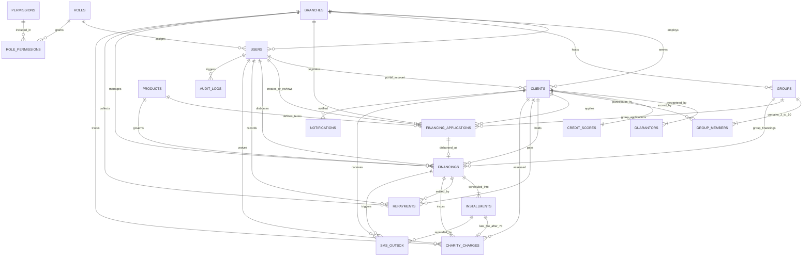

# SIMDA — Entity-Relationship Diagram (ERD)

All 21 relational tables use MySQL 8+ / MariaDB 10.11+ `InnoDB` with `utf8mb4_unicode_ci` collation, strict primary and foreign key constraints, and `DECIMAL(15,2)` monetary columns.

